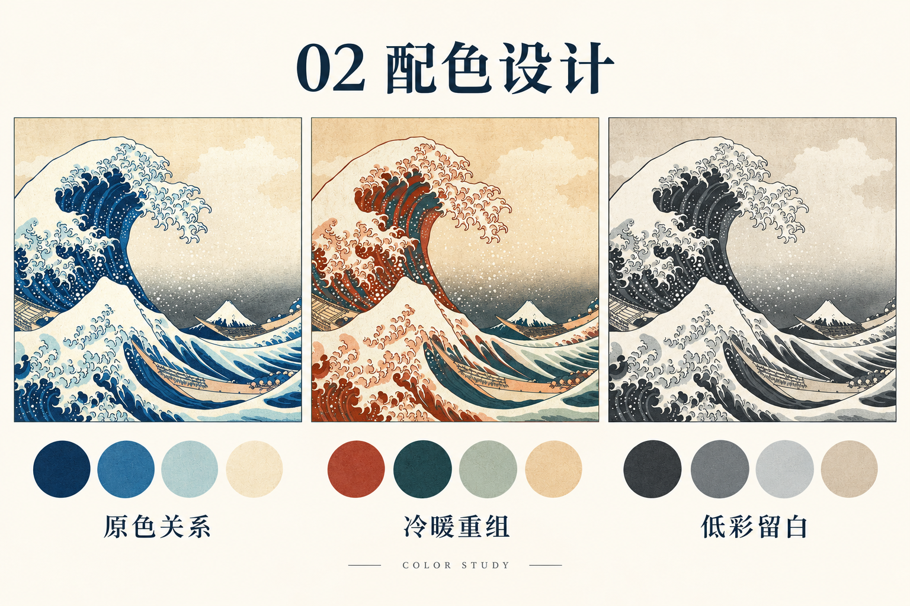
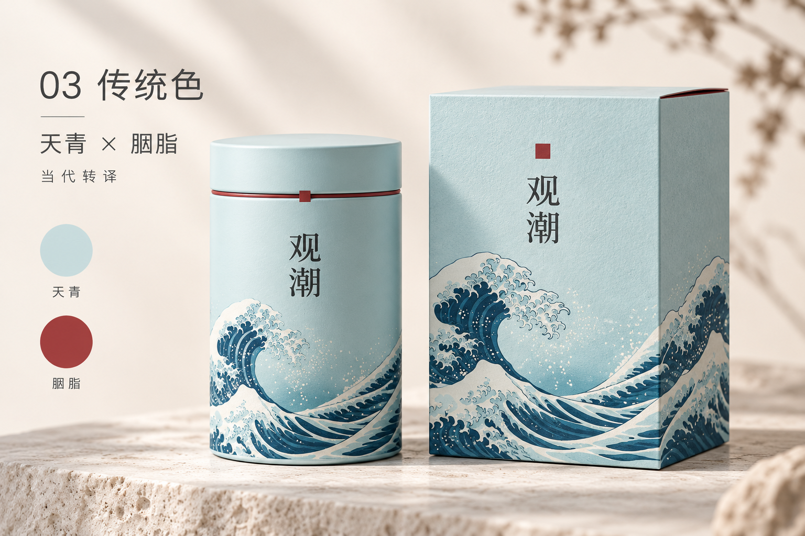
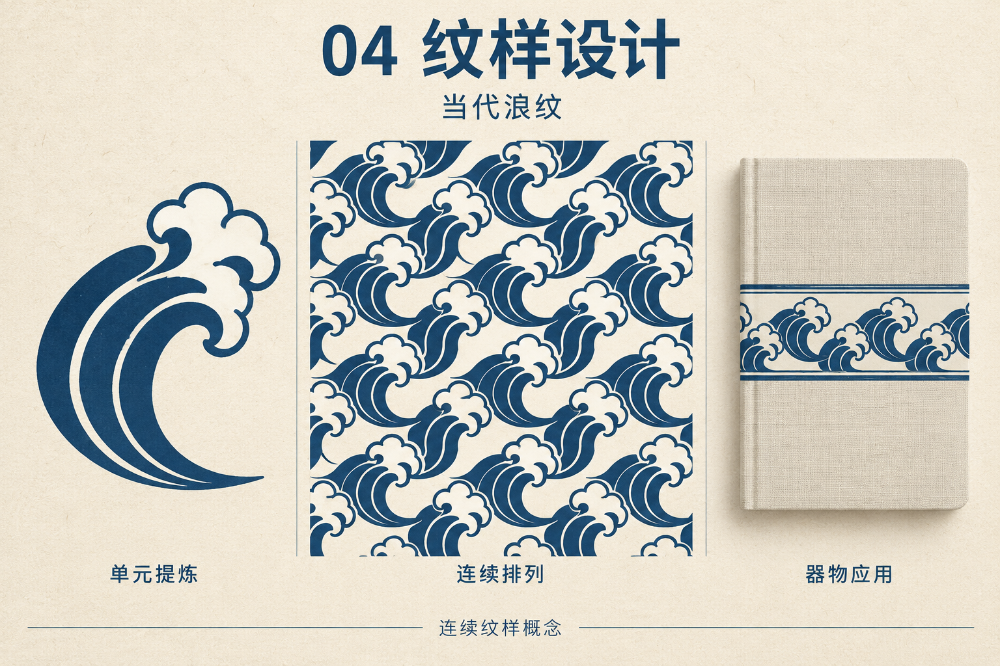
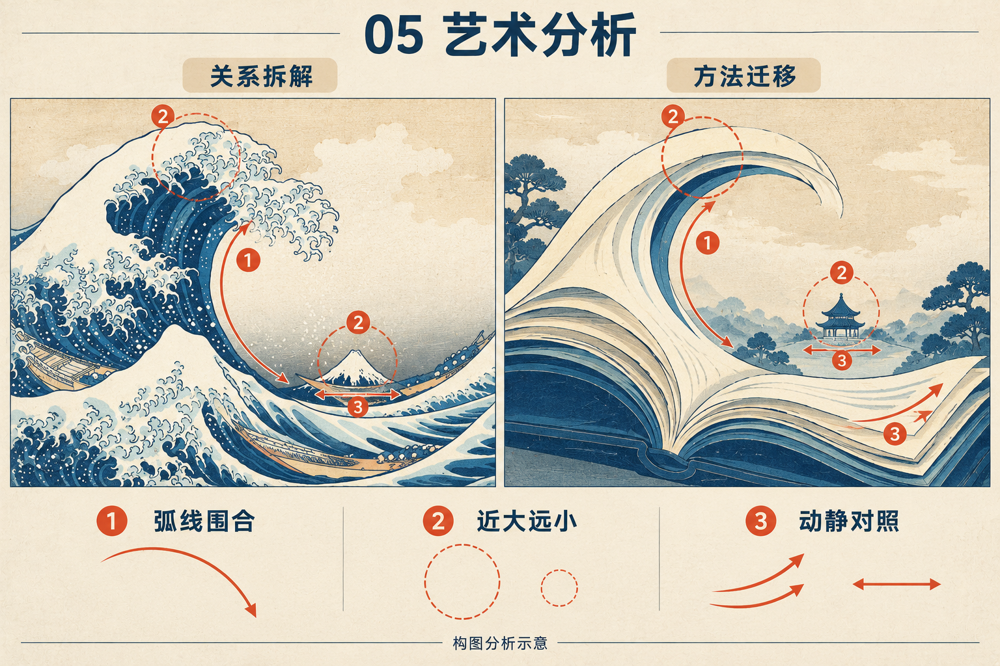
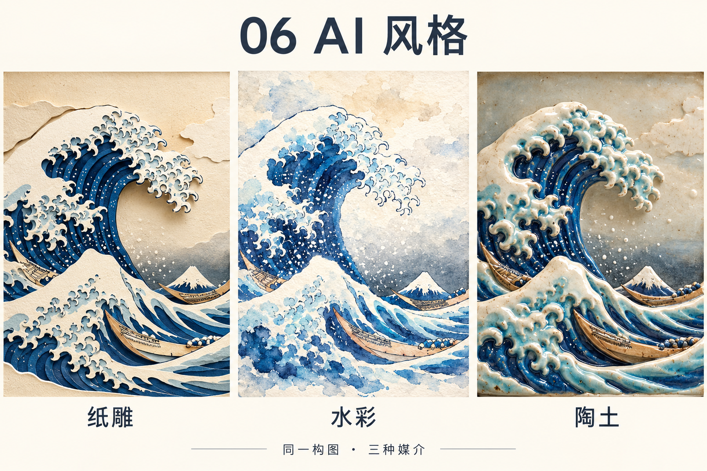

# Dreamie Design

把参考图、设计目标和真实内容，转成可比较、可制作、可检查的视觉方案。

Dreamie Design 是一个按任务调用的视觉设计 Skill，覆盖版式、配色、中国传统色、纹样、艺术分析和 AI 风格。它帮助代理明确设计决定、组织提示词、调用当前环境的制作工具，并查看结果、提出修正。

## 它能帮你做什么

| 能力 | 适合解决的问题 | 可以得到什么 |
|---|---|---|
| 版式设计 | 信息拥挤、主次不清、图文关系松散 | 阅读层级、网格与留白、海报或长图的排版方案 |
| 配色设计 | 色调不统一、颜色抢戏、文字不清楚 | 有用途的色板、同内容配色对照、调整与验收建议 |
| 中国传统色 | 想用传统色名，又希望适合现代品牌 | 色名与语境核验、颜色角色、包装与器物的当代配色 |
| 纹样设计 | 从参考形态发展装饰图案与系列 | 母题提炼、连续组织、载体应用与制作规格 |
| 艺术分析 | 喜欢一张作品，却不知道如何借鉴 | 构图、色彩、线条和节奏拆解，以及新主题的迁移方案 |
| AI 风格设计 | 风格词很多，生成结果仍不稳定 | 风格卡、可执行提示词、媒介对照和生成后的修正 |

一个入口，按需读取六个专题；可以单独使用，也可以在同一任务里组合。

## 看看实际效果

下面五张图使用同一幅参考作品，展示不同专题会怎样影响设计。画面由当前环境的 OpenAI 图像生成工具实际生成，Skill 提供设计方法与执行指引。

这些是视觉概念示例：参考画面经过 AI 重绘，适合比较方向；不代表逐像素改色、已完成的可编辑矢量文件或经过实物打样的产品。

### 配色：让同一画面出现不同气质

保持相近的主体与构图，比较蓝与暖纸色、陶土红与青绿、低彩灰调三种关系。帮助你判断颜色怎样改变焦点、冷暖与整体情绪，再把选定方向应用到真实内容中。



```text
用 $dreamie-design 为这张参考图做三套配色，保持相近构图，
比较冷暖、明暗和强调色，并说明适合什么用途。
```

### 传统色：把文化意象落实到现代包装

以“天青 × 胭脂”为方向，用浅青承接大面积包装、深红形成小面积强调，同时考虑文字、纸张和罐体材质。帮助你把色名变成有主次、有用途的设计；历史复原与当代借鉴分别处理。



```text
用 $dreamie-design 给茶罐和纸盒做天青、胭脂的当代配色，
明确主辅关系、材质感与需要打样确认的部分。
```

### 纹样：从一个浪形发展成连续图案

先提炼轮廓、线条与负形，再安排重复节奏，最后观察它在笔记本上的应用。帮助你形成一套可以继续细化的图形语言；需要生产时再制作矢量单元并验证接边、缩放和工艺。



```text
用 $dreamie-design 从这张图提炼新的浪纹单元，
展示连续排列和器物应用，并列出矢量制作与接边验证要求。
```

### 艺术分析：把喜欢的构图转成自己的方案

识别弧线围合、近大远小、动静对照，再将这些关系迁移到“翻卷书页与远处阅读亭”。帮助你解释画面为什么成立，并找到适合新题材的具体改法。



```text
用 $dreamie-design 分析参考图的构图关系，
再迁移到阅读主题，说明保留了什么关系、替换了什么对象。
```

### AI 风格：比较媒介，而不只堆风格词

沿用相近的浪、舟与远山构图，分别尝试纸雕、水彩、陶土，比较边缘、透明度、体积与光影。帮助你把“想要的感觉”写成可执行描述，再根据实际结果调整。



```text
用 $dreamie-design 把同一场景做成纸雕、水彩、陶土三个方向，
尽量保持构图一致，比较材质与光影，并实际生成后检查。
```

参考作品为葛饰北斋的《神奈川冲浪里》，大都会艺术博物馆藏品 JP1847，馆方标记为 Public Domain。[查看作品与使用信息](https://www.metmuseum.org/art/collection/search/45434)。纹样与包装均为当代设计演示，不作历史归属或复原主张。示例状态见[素材与验证说明](assets/examples/README.md)。

## 开始使用

把仓库作为名为 `dreamie-design` 的技能目录安装到代理工具支持的位置，保留 `SKILL.md`、`references/` 等相对结构。也可以使用 [Releases 中的安装包](https://github.com/heydreamie/dreamie-design/releases/latest)。

安装后输入 `$dreamie-design`，再说明用途、受众、真实文案、参考图和必须保留的内容。例如：

```text
用 $dreamie-design 改进这张文化展海报，保留品牌色，
先解决阅读层级，再检查配色；兼顾手机传播和 A3 打印。
```

技能入口：[SKILL.md](SKILL.md)。生成、排版、矢量编辑等实际能力取决于当前环境可用工具；没有执行过的步骤会明确标为待完成。

## 持续完善

通过新的设计案例、使用反馈与真实结果更新相关专题，保留适用条件、反例和验证状态。维护流程见 [CONTRIBUTING.md](CONTRIBUTING.md)，版本变化见 [CHANGELOG.md](CHANGELOG.md)。

维护者可在仓库根目录运行：

```sh
python scripts/check_skill.py
python -m unittest discover -s tests -v
python scripts/check_skill.py --package dist/dreamie-design.zip
```

ZIP 为 `dreamie-design/` 单目录，不含 Git 历史、维护测试、缓存和私人配置。仓库目前未指定开源许可证。
